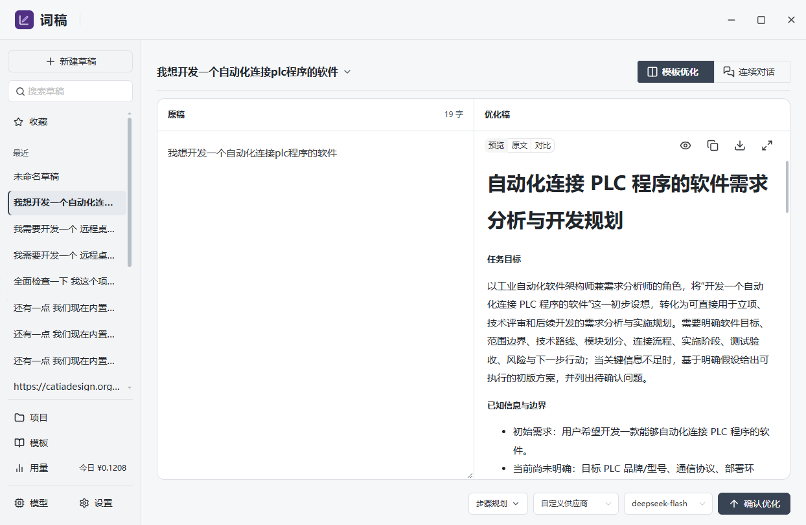
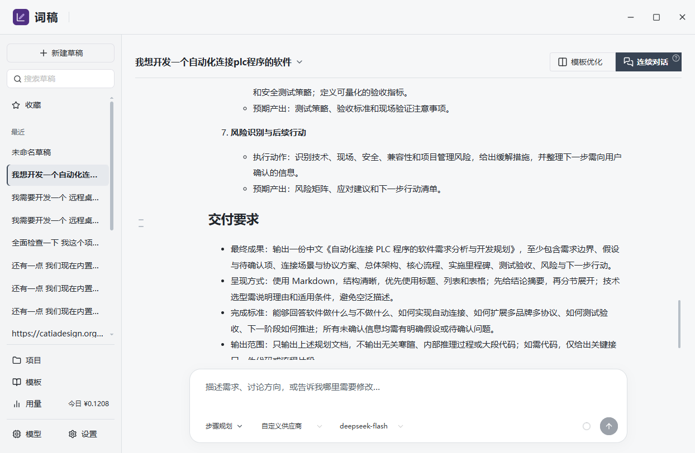
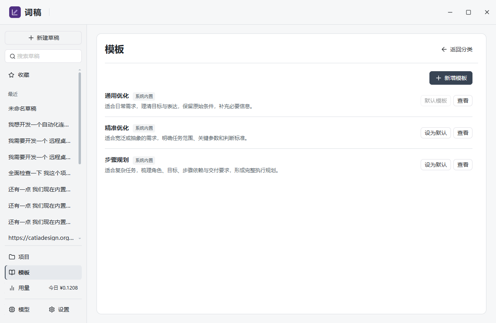
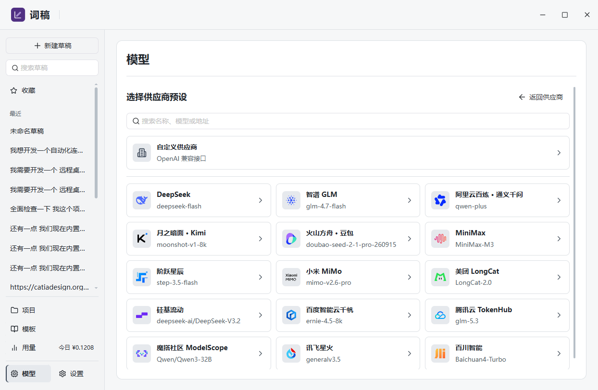
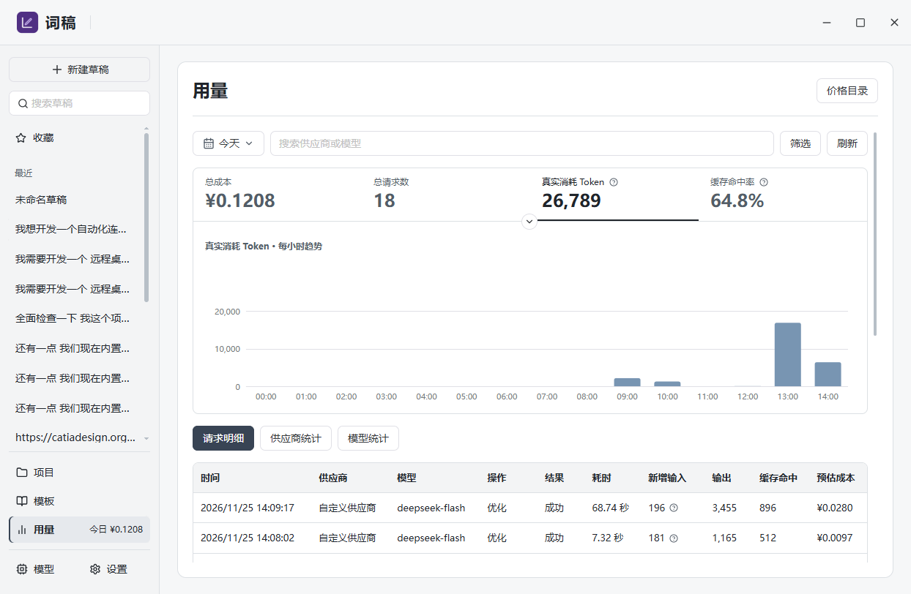

<div align="center">
  
  <h1>词稿</h1>
  <p><strong>把一句想法，打磨成清晰的提示词。</strong></p>
  <p>Windows 桌面提示词编辑器 · 模板优化 · 连续对话 · 本地草稿管理</p>
  <p>
    <a href="https://gitee.com/liuliang6666/prompt-draft/releases">Gitee 下载</a> ·
    <a href="https://github.com/zorvilo/prompt-draft/releases">GitHub Download</a> ·
    <a href="#快速开始">快速开始</a> ·
    <a href="#界面预览">界面预览</a> ·
    <a href="#开发">本地开发</a> ·
    <a href="THIRD_PARTY_NOTICES.md">开源致谢</a>
  </p>
</div>



词稿把原稿、优化结果和后续讨论放在同一个工作空间。连接自己的模型供应商，选择模板生成提示词，再通过连续对话补充约束、调整表达；草稿与聊天记录保存在本机，方便下次继续。

## 核心功能

| 功能       | 你可以做什么                                                         |
| ---------- | -------------------------------------------------------------------- |
| 双栏优化   | 对照原稿与优化稿，切换 Markdown 预览、原文和差异对比，复制或导出结果 |
| 连续对话   | 围绕最近一次优化继续讨论，补充需求并更新优化稿，保留历史记录         |
| 模板管理   | 使用内置模板，创建自己的分类与模板，为不同任务复用优化要求           |
| 草稿与项目 | 按项目整理草稿，搜索、收藏、置顶，在多个任务间切换                   |
| 模型配置   | 使用国内供应商预设或自定义 OpenAI 兼容接口，按草稿保存模型选择       |
| 用量统计   | 查看请求记录、Token 分项、缓存命中率与人民币预估费用                 |
| 本地备份   | 导出完整 JSON 备份，在同版本应用中恢复数据与配置                     |

## 快速开始

安装包在 [Gitee Releases](https://gitee.com/liuliang6666/prompt-draft/releases) 和 [GitHub Releases](https://github.com/zorvilo/prompt-draft/releases) 同步发布，选择你能顺畅访问的平台下载。同一版本使用相同安装包；尚无附件时可从源码运行。

当前正式版从 0.1.0 开始，面向 Windows。下载安装包后即可启动；从源码运行请参阅[开发](#开发)。使用前需要准备模型供应商的 API Key，模型调用费用由对应供应商收取。

### 1. 连接模型

打开左下角「模型」→「添加供应商」，选择供应商预设，或使用自定义 OpenAI 兼容接口。填写 API Key，选择默认模型，测试连接后保存；可通过「获取模型」同步可用模型目录。

### 2. 写下原稿

点击「新建草稿」或按 `Ctrl+N`，在左栏写下想法、需求或待改写的提示词。选择模板、供应商和模型，点击「确认优化」或按 `Enter`。

### 3. 继续打磨

在右栏预览、对比和复制优化结果。需要补充条件时，切换到「连续对话」继续讨论。重新执行模板优化会基于当前原稿开始新的上下文，旧聊天仍可回看。

## 界面预览

### 连续对话

在同一份草稿中继续补充要求，逐步打磨结果。



<details>
<summary><strong>模板管理</strong> — 为不同任务选择和维护优化模板</summary>



</details>

<details>
<summary><strong>模型供应商</strong> — 预设接入与自定义兼容接口</summary>



</details>

<details>
<summary><strong>用量统计</strong> — 查看 Token、缓存命中与预估费用</summary>

费用根据本地价格配置估算，以供应商实际账单为准。



</details>

## 数据与隐私

- **本地保存**：草稿、聊天记录、模板、设置和供应商配置保存在本机 SQLite 数据库中，路径为 `%APPDATA%\cn.promptdraft.desktop\prompt-draft.sqlite`。
- **模型请求**：生成时，相关提示词与对话上下文会发送到你配置的供应商地址；本地保存不代表模型推理离线运行。
- **密钥管理**：API Key 保存在本机数据库，仅由 Rust 读取。请妥善保护本机数据文件。
- **完整备份**：在「设置 → 数据与备份」中导出或恢复。备份包含明文 API Key；恢复会覆盖现有数据，不合并，校验失败会回滚。开机自启设置不随备份迁移。

> 测试阶段仅维护当前数据库结构，不提供历史数据库迁移及旧版备份兼容。更新前建议导出备份。

## 开发

基于 **Vue 3 + TypeScript + Naive UI + Tauri 2 + Rust + SQLite**。

在 Windows 安装 Node.js、Rust、Visual Studio C++ 构建工具和 WebView2，详见 [Tauri 环境要求](https://v2.tauri.app/start/prerequisites/)。

```powershell
npm ci
npm run tauri dev
```

运行项目检查：

```powershell
npm run check
node tests/model-presets.mjs
node tests/templates.mjs
node tests/shortcuts.mjs
node tests/workspace-changes.mjs
node tests/hover-scroll-text.mjs
```

运行 `npm run tauri build` 生成 Windows NSIS 安装包。

- [开发规范与交互约定](AGENTS.md)
- [应用更新与发布流程](RELEASING.md)

## 致谢与许可证

感谢以下开源项目及其贡献者：

| 项目                                                              | 版权与许可                                                  |
| ----------------------------------------------------------------- | ----------------------------------------------------------- |
| [Prompt Optimizer](https://github.com/linshenkx/prompt-optimizer) | Copyright (C) 2025 linshenkx · 上游当前许可证 AGPL-3.0-only |
| [CC Switch](https://github.com/farion1231/cc-switch)              | Copyright (c) 2025 Jason Young · MIT                        |
| [Lobe Icons](https://github.com/lobehub/lobe-icons)               | 供应商品牌 SVG · [许可证](src/assets/providers/LICENSE)     |

项目自有代码采用 [Apache-2.0](LICENSE)。第三方内容保留各自的版权和许可条件，完整说明见[第三方版权声明](THIRD_PARTY_NOTICES.md)，上游许可证保存在 [third-party](third-party/) 目录，并随应用分发。项目自有代码的 Apache-2.0 许可不替代上游内容适用的许可义务。
